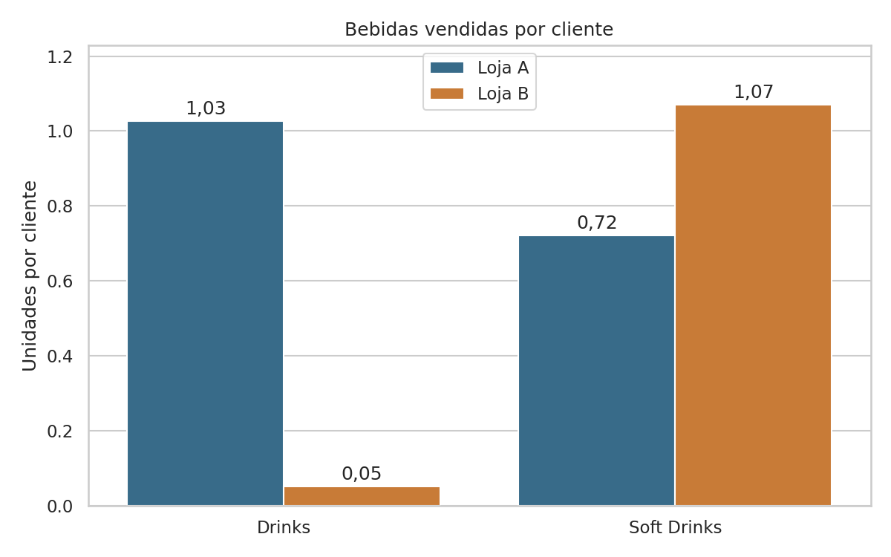
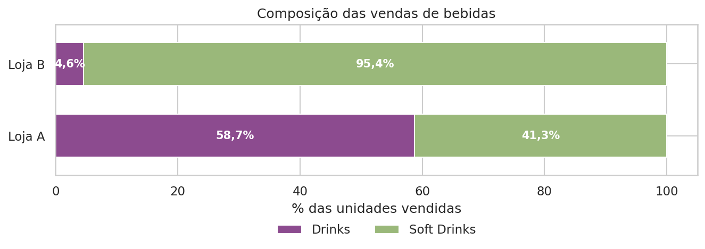
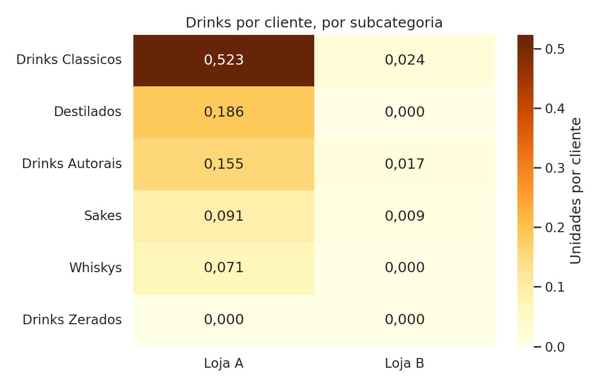
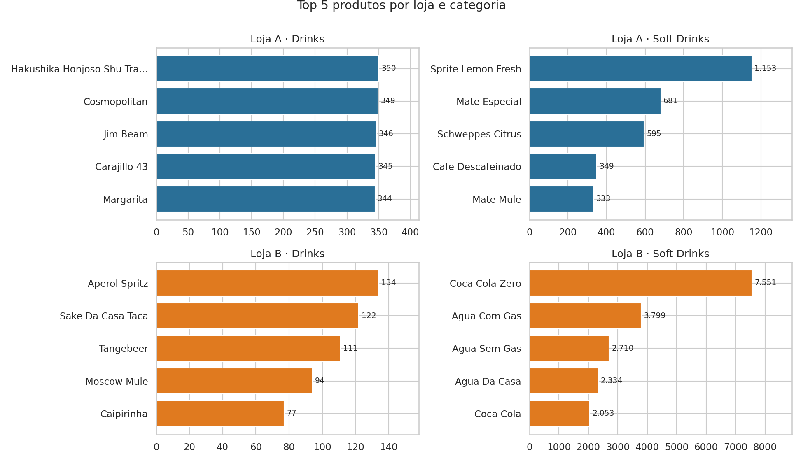

# Consumo de bebidas por cliente: comparação entre duas lojas

Análise exploratória de dados que compara o consumo de bebidas de duas lojas de um restaurante, usando uma métrica que corrige a diferença de público entre elas: **bebidas vendidas por cliente atendido**.

**Ferramentas:** Python · pandas · matplotlib · seaborn · plotly · Jupyter

> **Origem dos dados:** projeto prático desenvolvido a partir do vídeo [Projeto Prático de Análise de Dados com Python e Pandas](https://www.youtube.com/watch?v=RFJopzRpCJY), do canal Eficiência Programada. Os dados vêm do material do vídeo, e o autor informa que alterou alguns valores antes da análise, portanto **não representam vendas reais** e os resultados servem apenas como exercício. Nesta versão, as lojas foram renomeadas para Loja A e Loja B.

---

## Pergunta de negócio

Quantas bebidas, por categoria, cada loja vende **por cliente** e como os perfis de consumo das duas lojas se diferenciam?

Comparar o volume absoluto seria injusto, porque a Loja B atende cerca de 2x o público da Loja A. Por isso, a métrica central é *unidades vendidas ÷ clientes atendidos*.

## Principais resultados

> Como os valores foram alterados pelo autor do vídeo, os resultados abaixo ilustram a técnica de análise e não o desempenho real de nenhum negócio.

| | Loja A | Loja B |
|---|---|---|
| Clientes por dia (média) | 234 | 474 |
| Drinks por cliente | **1,03** | **0,05** |
| Soft drinks por cliente | 0,72 | 1,07 |
| Drinks no mix de bebidas | 58,7% | 4,6% |

- A Loja A vende cerca de **20x mais drinks por cliente** que a Loja B; em soft drinks, a Loja B vende cerca de 1,5x mais.
- A diferença aparece em **todas as subcategorias com álcool** (clássicos, autorais, destilados, sakes, whiskys).
- O público é muito estável ao longo da semana, com menos de 5% de diferença entre o melhor e o pior dia, então a sazonalidade semanal não explica a diferença.









## Processo

1. **Validação:** nulos, duplicatas, quantidades negativas e consistência entre data e dia da semana.
2. **Tratamento:** ordenação dos dias da semana e soma do público diário por loja.
3. **Análise:** público por dia da semana, bebidas por cliente, mix de categorias, subcategorias e top produtos.
4. **Qualidade dos dados:** investigação de uma concentração incomum de quantidades na Loja A.
5. **Dashboard interativo** em HTML, com Plotly.

## Além da análise base

A análise base calcula bebidas por cliente e os produtos mais vendidos por loja. Este repositório acrescenta:

- Validação dos dados antes da análise
- Público por dia da semana
- Mix de categorias e detalhamento por subcategoria
- Checagem da distribuição das quantidades
- Dashboard interativo com Plotly
- Documentação: conclusões, limitações e próximos passos

## Limitações

- Os valores foram alterados pelo autor do vídeo, então os dados **não representam vendas reais**.
- O consumo vem como **total do período**, sem data, então não dá para medir tendência nem cruzar com dia da semana.
- Na Loja B há duas linhas por dia (`tabela_preco` 0 e 1). Assumi que o público do dia é a soma das duas, mas isso precisa ser confirmado.
- Na Loja A, 36% dos produtos venderam entre 300 e 350 unidades, uma concentração incomum que provavelmente decorre das alterações de valores feitas pelo autor.
- As categorias seguem a classificação do cadastro (por exemplo, café e mates entram em *Soft drinks*).

## Como reproduzir

```bash
git clone https://github.com/GabrielMarteloti/analise-consumo-bebidas.git
cd analise-consumo-bebidas
pip install -r requirements.txt
jupyter notebook analise_drinks.ipynb
```

O arquivo `dashboard_interativo.html` é gerado pelo notebook e carrega o Plotly pela internet; basta abri-lo no navegador.

## Estrutura

```
├── analise_drinks.ipynb         # notebook completo, com saídas
├── dashboard_interativo.html    # gráficos interativos
├── dados/
│   ├── clientes.csv             # clientes atendidos por dia
│   └── consumo_bebidas.csv      # unidades vendidas por produto
├── images/                      # gráficos usados neste README
└── requirements.txt
```

## Crédito

Projeto prático baseado no vídeo [Projeto Prático de Análise de Dados com Python e Pandas](https://www.youtube.com/watch?v=RFJopzRpCJY), do canal **Eficiência Programada**.

## 👤 Autor

**Gabriel Marteloti** · [LinkedIn](https://www.linkedin.com/in/gabriel-marteloti-815750329/)
